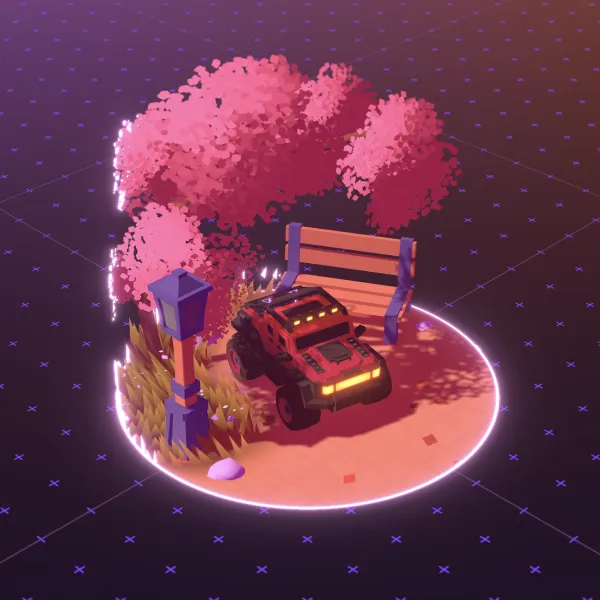
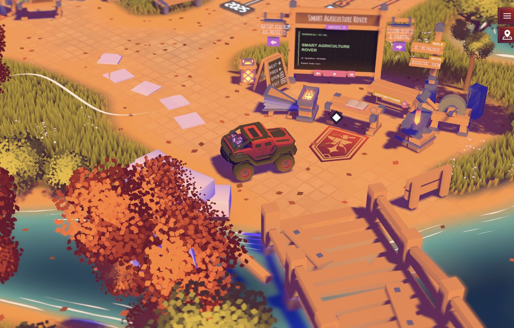

# Sharvin's Portfolio

An interactive 3D portfolio for Sharvin SJ — a 13-year-old AI and machine-learning engineer from Coimbatore, India. Explore projects, achievements, social links, and a playable circuit in a small open-world scene.

**Visit the portfolio:** [vtrsharvin-sj.github.io/Sharvin-s-Portfolio](https://sharvinsj.com)

## Preview



| Projects | Achievements | Circuit |
| --- | --- | --- |
|  |  |  |

## Run it locally

You need [Node.js 22](https://nodejs.org/) and npm.

```bash
git clone https://github.com/vtrsharvin-sj/Sharvin-s-Portfolio.git
cd Sharvin-s-Portfolio
npm ci
npm run dev
```

Open the local address printed by Vite (usually [http://localhost:5173](http://localhost:5173)). The development command starts the site and its live WebSocket server.

Useful commands:

```bash
npm test       # Run server integration tests
npm run build  # Create the production frontend in dist/
npm start      # Run the production site and live server
```

## Update portfolio content

- Projects and portfolio details: `sources/data/portfolio.js`
- Social links: `sources/data/social.js`
- Deployment steps and hosting notes: [DEPLOYMENT.md](DEPLOYMENT.md)

## Publish

Pushing to `main` runs the GitHub Actions workflow. It builds the site, deploys the live server to Cloudflare Workers, and publishes the frontend to GitHub Pages. The repository needs the `CLOUDFLARE_API_TOKEN` Actions secret; setup instructions are in [DEPLOYMENT.md](DEPLOYMENT.md). Never commit API tokens or other secrets.

## Contact

- Email: [sharvin@sharvinsj.com](mailto:sharvin@sharvinsj.com)
- GitHub: [@vtrsharvin-sj](https://github.com/vtrsharvin-sj)
- X: [@sharvinsj](https://x.com/sharvinsj)
- Portfolio: [sharvinsj.com](https://sharvinsj.com)

## Credits and licenses

The original portfolio engine and assets retain their license notices. See [LICENSE](LICENSE) and [the music license](static/sounds/musics/license.md) for details.
